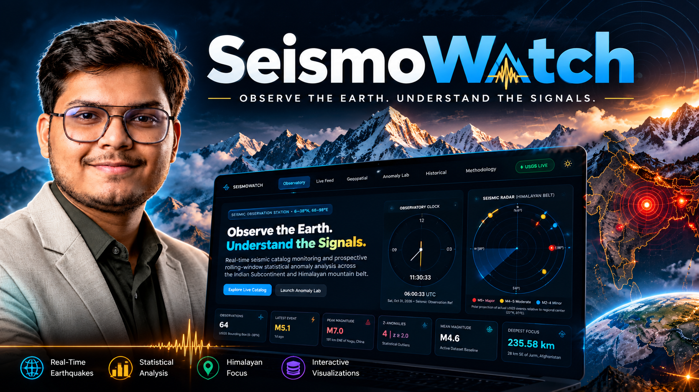
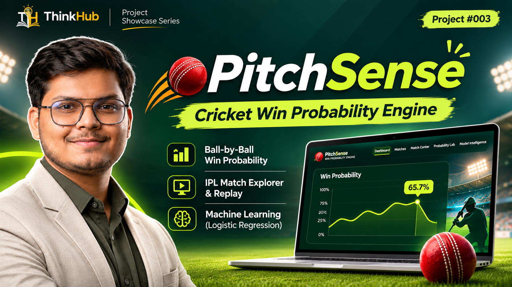

 <p align="center">
  
</p>

<h1 align="center">
  <a href="https://www.youtube.com/playlist?list=PLeK8iXKBaJgQ">
    The Build Log
  </a>
</h1>

<h3 align="center">Ideas. Projects. Development. Innovation.</h3>

<p align="center">
  
  
  
  
</p>

<p align="center">
  <i>Think. Learn. Grow.</i>
</p>

---

## 🚀 About The Build Log

**The Build Log** is an original project-building series by **ThinkHub**, created to document the journey of turning ideas into real-world digital products, applications, experiments, and innovative solutions.

From the first idea to the final deployment, this series takes viewers behind the scenes of actual development.

It explores how projects are conceptualised, planned, designed, developed, tested, improved, and launched using modern technologies and development tools.

Unlike traditional tutorials that focus only on the final result, **The Build Log focuses on the complete building journey — including experiments, challenges, failures, problem-solving, and breakthroughs.**

The series officially begins on **1st November 2026**, with new episodes on alternate Sundays.

> 🎯 **The mission:** Don't just talk about technology. Build with it, experiment with it, and show the journey.

---

<h2 align="center">🛠️ WHAT YOU'LL FIND HERE</h2>

<p align="center">
  This repository is the official public archive of The Build Log series.
</p>

<div align="center">

| 💡 CATEGORY | 🔍 WHAT WE EXPLORE |
|:---:|:---:|
| 🤖 Artificial Intelligence | AI applications, intelligent systems and experiments |
| 📊 Data Science | Data analysis, visualisation and insights |
| 🌐 Web Development | Websites, frontend and backend applications |
| ⚙️ Software Development | Programming, APIs and software architecture |
| 🧠 AI & Automation | AI agents, tools and automated workflows |
| 🚀 Product Building | Ideas, prototypes and digital products |
| ☁️ Deployment | GitHub, Vercel and cloud platforms |
| 🔬 Innovation | Experiments, testing and emerging technologies |

</div>

---

<h2 align="center">🎬 EPISODES ARCHIVE</h2>

<p align="center">
  <i>Every project has a story. Every build has a journey.</i>
</p>

<p align="center">
  New episodes are published on alternate Sundays at <strong>5:00 PM IST</strong>.
</p>

<h3 align="center">📅 NOVEMBER 2026</h3>

<div align="center">

| 🖼️ THUMBNAIL | 📅 DATE | 🎯 EPISODE | 💻 PROJECT | ▶️ VIDEO | 📑 SLIDES | 
|:---:|:---:|:---:|:---:|:---:|:---:|
|  | **01 Nov 2026** | **I Built AQI Sentinel 🌿 - Real Time Air Quality Monitoring & AI-Powered Health Advisory** | [GitHub Repo](https://github.com/dk-khandelwal06/aqi-sentinel) & [Live Link](https://aqi-sentinel.vercel.app/) | [▶️ Watch](https://youtu.be/dIm6qxmxOn8) | [📑 View Slides](https://drive.google.com/file/d/1Y2XBkcItr3q4TQvAAO3FCHjmQbMg6SL-/view?usp=sharing)
|  | **15 Nov 2026** | **SeismoWatch 🌍 - Building an Earthquake Monitoring & Anomaly Detection Platform** | [GitHub Repo](https://github.com/dk-khandelwal06/seismowatch) & [Live Link](https://seismowatch-sigma.vercel.app/) | [▶️ Watch]() | [📑 View Slides](https://drive.google.com/file/d/1KIRzKJ6OkXbl2BmdyMwQw1DyA4QP8Raf/view?usp=drive_link)
|  | **29 Nov 2026** | **PitchSense 🏏 - Predicting Cricket Match Winners Using Machine Learning** | [GitHub Repo](https://github.com/dk-khandelwal06/pitchsense) & [Live Link](https://pitchsense-black.vercel.app/) | [▶️ Watch]() | [📑 View Slides](https://drive.google.com/file/d/1B3TSitFTsHaAkxDliNmlgxWd1QnZhNcz/view?usp=drive_link)

</div>

<h3 align="center">📅 DECEMBER 2026</h3>

<div align="center">

| 🖼️ THUMBNAIL | 📅 DATE | 🎯 EPISODE | 💻 PROJECT | ▶️ VIDEO | 📑 SLIDES | 
|:---:|:---:|:---:|:---:|:---:|:---:|
|  | **13 Dec 2026** | **** | [GitHub Repo]() & [Live Link]() | [▶️ Watch]() | [📑 View Slides]()
|  | **27 Dec 2026** | **** | [GitHub Repo]() & [Live Link]() | [▶️ Watch]() | [📑 View Slides]()

</div>

<p align="center">
  <i>More projects and episodes will be added regularly.</i>
</p>

---

<h2 align="center">📊 SERIES SNAPSHOT</h2>

<div align="center">

| 📌 | DETAILS |
|:---:|:---:|
| 🎬 Series | The Build Log |
| 🏷️ Brand | ThinkHub |
| 📅 Launch Date | 1 November 2026 |
| 📆 Frequency | Alternate Sundays |
| 🕔 Premiere Time | 5:00 PM IST |
| 🎯 Focus | AI • Projects • Development • Innovation |
| 🎥 Format | Project Building & Development |
| 📺 Platform | YouTube |
| 👤 Creator | Daksh Khandelwal |

</div>

---

# 🔨 How The Build Log Works

<p align="center">
  <strong>IDEA → PLAN → BUILD → TEST → DEPLOY → SHARE</strong>
</p>

Every project follows a practical development journey:

1. 💡 **IDEA** — Identify a problem or interesting opportunity.
2. 📝 **PLAN** — Define objectives, features, architecture and tools.
3. 💻 **BUILD** — Develop the actual project and implement its features.
4. 🧪 **TEST** — Experiment, debug, evaluate and improve.
5. ☁️ **DEPLOY** — Make the project accessible through deployment.
6. 🎬 **SHARE** — Document the complete journey through The Build Log.

Not every project follows the exact same process. Some experiments may evolve, change direction, or lead to entirely new ideas.

---

<h2 align="center">📁 PROJECT DOCUMENTATION</h2>

<p align="center">
  Individual projects may include the following resources:
</p>

<div align="center">

| 📂 RESOURCE | 📝 DESCRIPTION |
|:---:|:---:|
| 💻 Source Code | Complete implementation |
| 📄 README | Project overview and setup |
| 🖼️ Screenshots | Interface and visual previews |
| 🎬 Demo Video | Project demonstration |
| 🌐 Live Demo | Deployed application |
| 📚 Documentation | Architecture and technical details |

</div>

---

# 🗂️ Repository Structure

```text
ThinkHub-Build-Log/
│
├── README.md
├── LICENSE
│
├── assets/
│   ├── thinkhub-logo.png
│   ├── thinkhub-banner.png
│   ├── thinkhub-watermark.png
│   ├── build-log-intro.mp4
│   └── build-log-outro.mp4
│
├── thumbnails/
│   ├── 01.png
│   ├── 02.png
│   ├── 03.png
│   └── ...
│
├── projects/
│   ├── project-01/
│   ├── project-02/
│   └── ...
│
└── documentation/
    ├── project-notes/
    └── resources/
```

---

# 📺 ThinkHub Content Universe

ThinkHub brings together different content formats, each with its own purpose.

### 📰 Beyond The Headlines

A daily news and analysis series exploring current affairs, technology, AI, geopolitics, business, science and the deeper perspective behind important headlines.

**Daily. News. Perspective.**

### 🎓 ThinkHub Decoded

A weekly educational series covering technology, artificial intelligence, data science, programming, career roadmaps, tutorials and important concepts.

**Weekly. Knowledge. Growth.**

### 🔨 The Build Log

A project-building series documenting real development journeys, experiments, AI applications, software projects and innovations.

**Build. Experiment. Create.**

---

# 🔗 Connect With ThinkHub

<p align="center">
  <a href="https://www.youtube.com/@ThinkHubbydaksh">
    
  </a>
  <a href="https://github.com/dk-khandelwal06">
    
  </a>
</p>

<p align="center">
  <strong>ThinkHub</strong> is a learning and technology-focused platform sharing knowledge, exploring ideas, building projects and documenting the journey of continuous growth.
</p>

---

<p align="center">
  
</p>

<h2 align="center">THINKHUB</h2>

<h3 align="center">THINK. LEARN. GROW.</h3>

<p align="center">
  <i>Ideas become projects. Projects become possibilities.</i>
</p>

---

<p align="center">
  © 2026 <strong>Daksh Khandelwal / ThinkHub</strong>
</p>

<p align="center">
  <a href="https://www.youtube.com/@ThinkHubbydaksh">YouTube</a>
  &nbsp; • &nbsp;
  <a href="https://github.com/dk-khandelwal06">GitHub</a>
</p>

<p align="center">
  ⭐ Follow ThinkHub and be part of the building journey!
</p>
